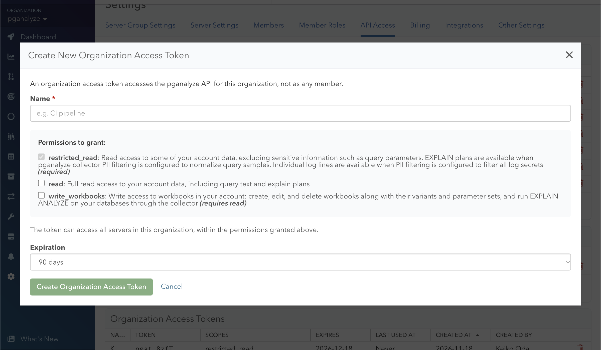

import DocsEarlyAccessFeature from '../components/DocsEarlyAccessFeature'

<DocsEarlyAccessFeature feature="Organization access tokens" />

An organization access token lets a script, agent, or CI job call the pganalyze [GraphQL API](/docs/api) or [MCP server](/docs/mcp) on behalf of your organization, rather than on behalf of a member. The token belongs to the organization and carries only the scopes chosen when it was created, so it keeps working when the person who created it leaves the organization.

Use an organization access token for shared automation, such as a CI pipeline or a background agent that a team relies on. To act as yourself, with your own account permissions, use a [personal access token](/docs/api/personal-access-tokens) instead. See [Authentication](/docs/api/authentication) to compare the options.

Organization access tokens are not yet available on pganalyze Enterprise Server.

## How access is determined

An organization access token is not tied to any member's account permissions. Its access is determined by the following:

- **The token's scopes**, chosen when the token is created (see [Scopes](#scopes)).
- **The organization.** The token can access all servers in the organization it was created in, and no other organization.

An organization access token can read data and, with the Workbook write access scope, create and edit workbooks. It cannot perform actions that require the [Modify](/docs/accounts/permissions#modify), [Billing](/docs/accounts/permissions#billing), [API](/docs/accounts/permissions#api), or [Manage](/docs/accounts/permissions#manage) permissions, such as changing settings, viewing API keys, or managing members. It also cannot create or revoke access tokens, and has no access to data that only applies to a person, such as user profile details or OAuth authorizations.

Since an organization access token can access every server in the organization, grant only the scopes the integration needs.

## Creating an organization access token

Only members with the [Manage permission](/docs/accounts/permissions#manage) can create, view, and revoke organization access tokens.

1. Go to **Settings > API Access** for your organization.
2. In the **Organization Access Tokens** section, click **Create Organization Access Token**.
3. Enter a name that tells your team where the token is used, for example "CI pipeline" or "Nightly query review agent".
4. Select the [scopes](#scopes) to grant.
5. Choose an expiration: 30 days, 60 days, 90 days (the default), 1 year, or no expiration.
6. Click **Create Organization Access Token**.



The token is shown only once, right after you create it. Copy it and store it somewhere safe, such as a secrets manager. pganalyze stores only a hash of the token and cannot show it to you again.

Like personal access tokens, organization access tokens start with `pgat_`. The Organization Access Tokens section lists each token by name and the first few characters of the token, so you can tell them apart without the full value.

## Scopes

Organization access tokens use the same [scopes](/docs/api/authentication#scopes) as personal access tokens and OAuth. Basic read access (`restricted_read`) is always granted, and Full read access (`read`) and Workbook write access (`write_workbooks`) are optional. See [Scopes](/docs/api/authentication#scopes) for what each scope allows.

Unlike a personal access token, an organization access token does not need the [Create Workbooks permission](/docs/accounts/permissions#create-workbooks) to use Workbook write access. The scope alone allows it to create workbooks and run `EXPLAIN ANALYZE` through the collector on any server in the organization.

## Using an organization access token

Pass the token in the `Authorization` header, using either the `Bearer` or `Token` scheme.

### GraphQL API

```bash
curl -XPOST -H 'Authorization: Bearer pgat_XXXXXXX' -F 'query=query { getServers(organizationSlug: "your-organization") { id, name } }' https://app.pganalyze.com/graphql
```

See [Queries](/docs/api/queries) for the available endpoints.

### MCP server

Configure your MCP client to send the token as a Bearer token. For example, with Claude Code:

```bash
claude mcp add --transport http \
  pganalyze https://app.pganalyze.com/mcp \
  -H "Authorization: Bearer pgat_XXXXXXX"
```

See [MCP Server](/docs/mcp) for the available tools and how to configure other MCP clients.

### Workbooks created with an organization access token

Workbooks created with an organization access token are not owned by a member. pganalyze shows the token's name as the workbook's owner, and attributes workbook activity, such as new variants and `EXPLAIN ANALYZE` runs, to the token's name.

## Revoking an organization access token

To revoke a token, click the trash icon next to it in the Organization Access Tokens section. Any member with the Manage permission can revoke any organization access token. Revocation takes effect immediately.

Organization access tokens are not revoked when the member who created them leaves the organization. The **Created By** column marks a creator who is no longer a member. Since that person may still have a copy of the token, consider revoking it and creating a new one.
