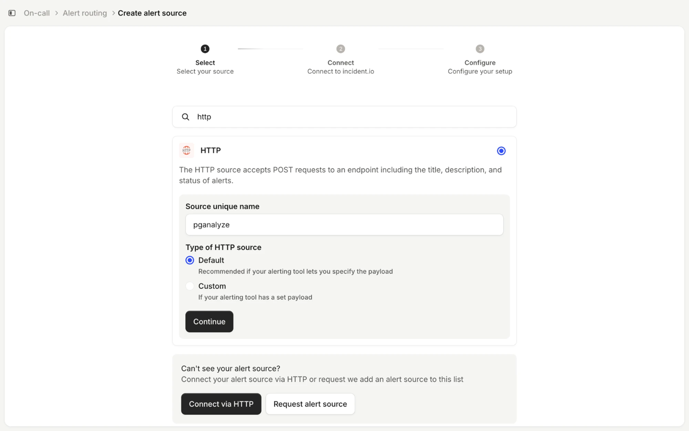
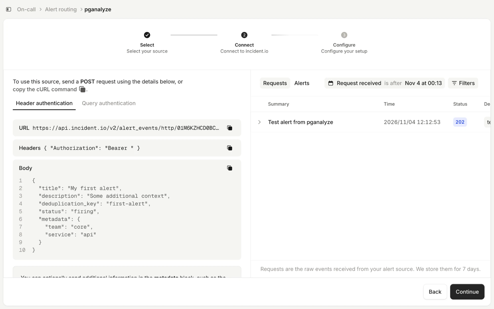
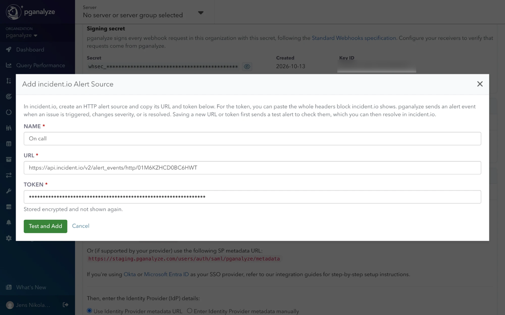
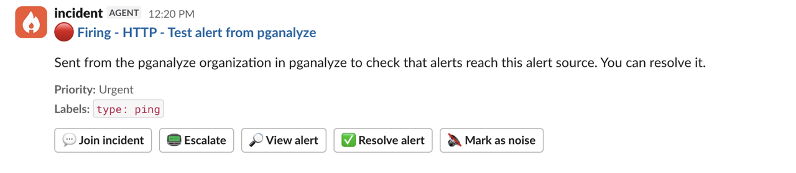
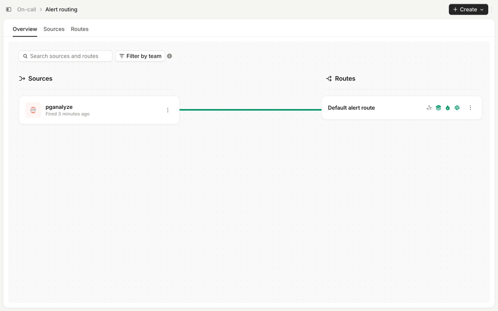
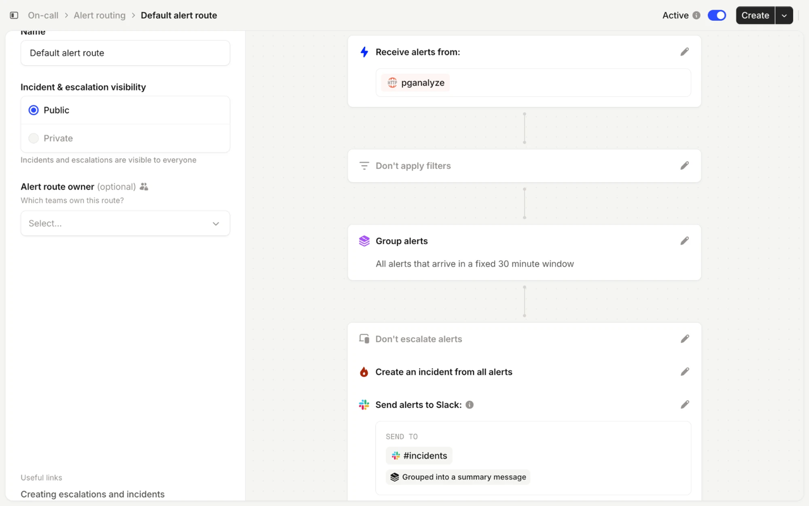

import DocsEarlyAccessFeature from '../components/DocsEarlyAccessFeature'

<DocsEarlyAccessFeature feature="incident.io integration" />

The [incident.io](https://incident.io) integration sends [Alerts & Check-Up](/docs/checks) issues to an
[HTTP alert source](https://docs.incident.io/alerts/alert-sources#default-http) in incident.io,
where your alert routes can page on-call, open incidents, or post to Slack.

Managing incident.io alert sources requires organization-wide [modify permissions](/docs/accounts/permissions).

## Overview

Each pganalyze issue becomes one incident.io alert, linked back to the issue. pganalyze sends
an alert event when an issue is triggered, changes severity, or is resolved, for issues of all
severities. Acknowledging or reopening an issue is not sent, since incident.io alerts have no
acknowledged state.

Each event carries the issue details in `metadata`, which you can map to alert attributes in
incident.io and use in routes and filters. It has the same fields as the `data` object of the
[webhook payload](/docs/checks/webhooks#overview), without the description, query text, and
details, which are in the alert description instead. Useful fields include:

| Field | Example |
|---|---|
| `metadata.issue.severity` | `critical`, `warning`, `info` |
| `metadata.issue.checkKind` | `queries/slowness` |
| `metadata.server.name` | `prod-db` |
| `metadata.server.tags` | `{ "env": "production" }` |
| `metadata.database.name` | `app_production` |

Retries and automatic disabling work [as for webhooks](/docs/checks/webhooks#overview). If a
newer event for the same issue exists, pganalyze skips retrying the older one, so incident.io
never receives an outdated status.

## Setup

### 1. Create an HTTP alert source in incident.io

1. Go to **On-call** > **Alert routing**, click **Create**, and choose to create an alert source
2. Search for "http", select **HTTP**, and enter a **Source unique name**, for example "pganalyze"
3. Keep **Default** as the **Type of HTTP source** and click **Continue**. pganalyze already sends events in incident.io's alert schema.

The **Connect** step shows the **URL** and **Headers** pganalyze needs. Keep it open for the next step.

### 2. Add the alert source in pganalyze

1. Go to **Settings** > **Integrations**
2. In the **incident.io** panel, click **Add Alert Source**
3. Enter a name, then paste the **URL** and the **Token**. You can paste the whole headers block from incident.io.
4. Click **Test and Add**. pganalyze sends a test alert and only adds the alert source if incident.io accepts it.

The test alert shows up under **Requests** in incident.io. Click **Continue** there to finish
the setup. The test alert then follows your alert routes like any other alert. Resolve it in incident.io.

### 3. Route issues to incident.io

In pganalyze, add the alert source to an alert destination and route checks to it, the same
way as [for webhooks](/docs/checks/webhooks#3-route-issues-to-the-webhook).

In incident.io, **On-call** > **Alert routing** shows which alert routes receive pganalyze alerts:

Edit a route to decide what pganalyze alerts do: filter, group, escalate, create incidents, or post to Slack.
To page only on critical issues, filter on `metadata.issue.severity`.

## Managing alert sources

Click an alert source's name in the **incident.io** panel to **Send test alert**, **Edit**,
**Disable**, or **Remove** it, and to see its deliveries. This works the same way as
[managing webhooks](/docs/checks/webhooks#managing-webhooks).
