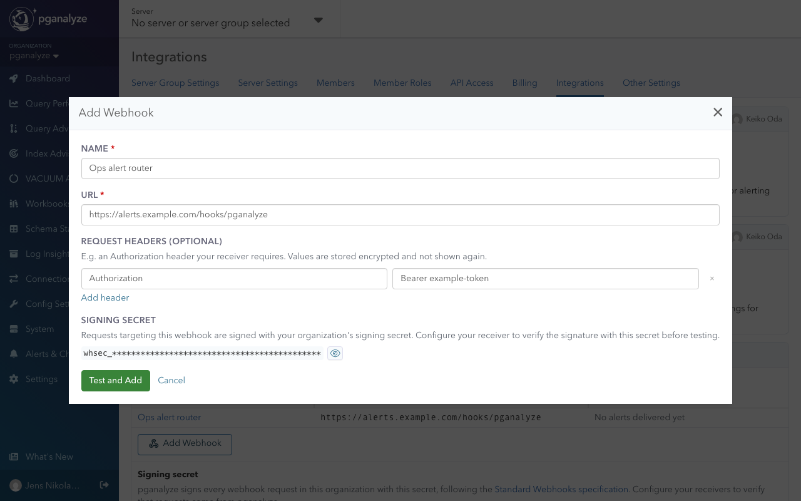
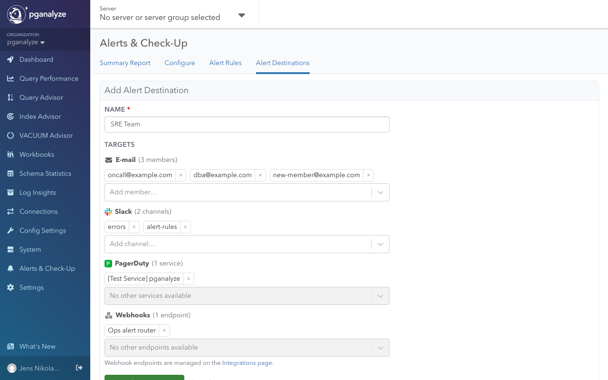
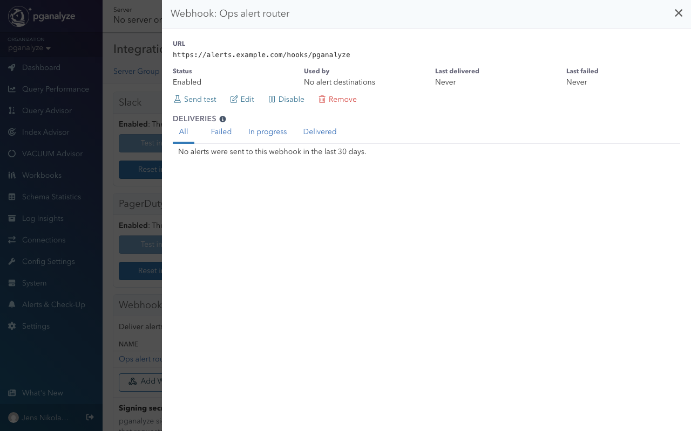

import DocsEarlyAccessFeature from '../components/DocsEarlyAccessFeature'

<DocsEarlyAccessFeature feature="Webhooks" />

Webhooks send [Alerts & Check-Up](/docs/checks) issues as signed HTTP requests to your
own endpoints, so you can connect pganalyze to your own services or any tool that
accepts webhooks. Webhooks receive issues of all severities.

Managing webhooks requires organization-wide [modify permissions](/docs/accounts/permissions).
Other members can view webhooks and deliveries for servers they have access to.

## Setup

### 1. Add the webhook

1. Go to **Settings** > **Integrations**
2. In the **Webhooks** panel, click **Add Webhook**
3. Enter a name and the URL. The URL must use HTTPS and resolve to a public address.
4. Optionally, add request headers, such as an `Authorization` header your receiver requires
5. Copy the **Signing secret** and configure your receiver to verify requests (see [step 2](#2-verify-requests))
6. Click **Test and Add**. pganalyze sends a `ping` event and only adds the webhook if it succeeds.

### 2. Verify requests

Requests follow the [Standard Webhooks](https://www.standardwebhooks.com/) specification,
so you can verify them with any Standard Webhooks library. Each request is a `POST` with a
JSON body and these headers:

* `webhook-id`: the event ID. It stays the same across retries, so you can use it to deduplicate.
* `webhook-timestamp`: the send time, in Unix seconds
* `webhook-signature`: `v1,` followed by a base64 HMAC-SHA256 of `{webhook-id}.{webhook-timestamp}.{body}`, signed with your signing secret

The signing secret is shared by all webhooks in the organization. Members with modify
permissions can reveal and copy it in the **Webhooks** panel.

### 3. Route issues to the webhook

1. Go to **Alerts & Check-Up** > **Alert Destinations** and add the webhook to a destination
2. On the **Alert Rules** tab, route the checks you want to that destination

See [Alerting](/docs/checks#alerting) for how destinations and rules work.

## Payload

Every payload includes `type`, `id`, `timestamp`, `version`, `organization`, and `data`.
For issue events, `data` contains the `endpoint`, `issue`, `server`, `database`, and
the `alertRules` and `alertDestinations` that routed it.

| Event type | Sent when |
|---|---|
| `issue.triggered` | An issue is created |
| `issue.escalated` | An issue's severity increases |
| `issue.downgraded` | An issue's severity decreases |
| `issue.acknowledged` | An issue is acknowledged |
| `issue.reopened` | An acknowledged issue is reopened |
| `issue.resolved` | An issue is resolved |
| `ping` | A webhook is tested |

If several alert rules route the same issue to one webhook, it receives a single request.

## Managing webhooks

Click a webhook's name in the **Webhooks** panel to open its details. From there you can
**Send test**, **Edit**, **Disable**, or **Remove** it. Changing the URL or request headers
requires a new successful test.

**Deliveries:** the webhook details list deliveries from the last 30 days, filterable by
status. Click a delivery's time to see its attempts, the response body excerpt, and the
payload. Test requests are not listed.

**Retries:** timeouts, connection and TLS errors, and HTTP 5xx, 408, 425, and 429
responses are retried up to 7 attempts over about 4 hours. Other responses fail
immediately. Redirects are not followed.

**Disabling:** a disabled webhook receives no requests, and pending deliveries show as
"Not sent (webhook disabled)". To enable it again, click **Test and enable**.

**Automatic disabling:** if 20 deliveries in a row fail over more than 24 hours,
pganalyze disables the webhook and e-mails organization members with manage permissions.

**Rotating the signing secret:** click **Rotate secret** in the **Webhooks** panel. For
7 days, requests are signed with both the new and the old secret, so you can update your
receivers.
