Below you can see the reference architecture for a scaled out version of pganalyze Enterprise Server. This diagram also illustrates how data gets sent between different components.

You can see two different options for the monitored environment below:

**Option 1:** Integration with cloud environments like AWS, Azure and GCP. The pganalyze collector runs in a container or VM in the same region as the monitored instance (e.g. Amazon Aurora).

**Option 2:** Self-managed Postgres servers running on-premise, in a virtual machine in the cloud, or using containerized deployments (e.g. with [CNPG](https://cloudnative-pg.io/)).

This diagram is focused on larger setups that [run the collector separately](/docs/enterprise/setup/separate-collector-install), sending data to an internal, central installation of pganalyze Enterprise Server. For small deployments and evaluations we recommend the [simplified installation](/docs/enterprise/setup/docker) (collector runs in the combined image and connects out).

```mermaid
---
config:
  flowchart:
    wrappingWidth: 400
---
flowchart TB
  accTitle: pganalyze Enterprise Server reference architecture
  accDescr: Collectors in a cloud environment or an on-premise / self-managed environment report to a central installation of pganalyze Enterprise Server over WebSocket Secure, behind an optional load balancer. The central installation uses a Redis server, an internal Postgres server, and an email server.

  subgraph cloud["Option 1: Cloud Environment"]
    cloudapi["<b>Cloud Provider API</b><br/>Logs / System Metrics"]:::existing
    subgraph g2[" "]
      direction TB
      subgraph cloudhost["Container / K8S / VM"]
        c1["<b>pganalyze</b><br/><b>collector</b>"]:::pga
      end
      n2["<i>Each collector can monitor</i><br/><i>one or more Postgres instances,</i><br/><i>and uses Cloud Provider APIs to</i><br/><i>collect logs/system metrics.</i><br/><br/><i>Collector can filter sensitive data.</i><br/><i>(query parameters, log events, ..)</i>"]:::note
      cloudhost ~~~ n2
    end
    subgraph g1[" "]
      direction TB
      rds["<b>Postgres Instance</b>"]:::existing
      n1["<i>Postgres is</i><br/><i>accessed</i><br/><i>using restricted</i><br/><i>monitoring user</i>"]:::note
      rds ~~~ n1
    end
    c1 pg1@-- "Postgres/5432" --> rds
    c1 -- "HTTPS/443" --> cloudapi
  end

  subgraph onprem["Option 2: On-Premise / Self-Managed Environment"]
    subgraph dbhost["Database Server VM / Kubernetes Cluster"]
      subgraph g4[" "]
        direction TB
        c2["<b>pganalyze</b><br/><b>collector</b>"]:::pga
        n4["<i>Collector can read logs &amp; system</i><br/><i>metrics directly from Linux hosts for</i><br/><i>on-premise / self-managed servers,</i><br/><i>or get logs via OTel for Kubernetes.</i>"]:::note
        c2 ~~~ n4
      end
      subgraph g3[" "]
        direction TB
        pg["<b>Postgres Server</b>"]:::existing
        n3["<i>Postgres is accessed using</i><br/><i>restricted monitoring user</i>"]:::note
        pg ~~~ n3
      end
      c2 pg2@-- "Postgres/5432" --> pg
    end
  end
  subgraph gu[" "]
    direction TB
    user["End User<br/>(e.g. DBA, developer)"]
    subgraph g6[" "]
      direction TB
      sso["<b>External SSO</b><br/><b>Identity Provider</b><br/>(optional)"]:::existing
      n6["<i>pganalyze can be configured to</i><br/><i>accept SAML-based logins.</i><br/><i>(Okta/Azure Entra ID/etc.)</i>"]:::note
      sso ~~~ n6
    end
  end
  subgraph central["Central Installation"]
    lb["<b>Load Balancer</b><br/>(optional)"]:::provisioned
    subgraph apphost["Container / Kubernetes / VM"]
      workers["<b>pganalyze</b><br/><b>Enterprise Server</b><br/>Background Task<br/>Workers"]:::pga
      web["<b>pganalyze</b><br/><b>Enterprise Server</b><br/>Web Server and<br/>Statistics Processing"]:::pga
      n8["<i>Container image has</i><br/><i>different commands for each</i><br/><i>component that’s deployed,</i><br/><i>can also run as single</i><br/><i>combined container.</i>"]:::note
    end
    smtp["<b>Email Server</b><br/>For alert emails,<br/>weekly reports"]:::provisioned
    db["<b>Postgres Server</b><br/>Internal DB for<br/>pganalyze"]:::provisioned
    subgraph g7[" "]
      direction TB
      redis["<b>Redis Server</b><br/>Queue for pganalyze<br/>(optional)"]:::provisioned
      n7["<i>Separate Redis Server is optional</i><br/><i>when deploying a single container,</i><br/><i>Redis runs in combined image by</i><br/><i>default.</i>"]:::note
      redis ~~~ n7
    end
  end

  c1 -- "WebSocket Secure/443<br/><br/><i>Collectors report server data to</i><br/><i>pganalyze installation and</i><br/><i>authenticate with collector API key.</i>" --> lb
  c2 -- "WebSocket Secure/443" --> lb
  user -- "HTTPS/443" --> lb
  user -- "HTTPS/443" --> sso
  web ~~~ n8
  lb -- "HTTP/5000" --> web
  workers -- "SMTP/587" --> smtp
  workers pg3@--> db
  web pg4@-- "Postgres/5432" --> db
  workers redis1@--> redis
  web redis2@-- "Redis/6379" --> redis
  style gu fill:none,stroke:none
  style g1 fill:none,stroke:none
  style g2 fill:none,stroke:none
  style g3 fill:none,stroke:none
  style g4 fill:none,stroke:none
  style g6 fill:none,stroke:none
  style g7 fill:none,stroke:none

  classDef pg stroke:#1282A6
  class pg1,pg2,pg3,pg4 pg
  classDef redis stroke:#FA8072
  class redis1,redis2 redis
  %% legend pga: New component provided by pganalyze
  %% legend provisioned: New service / cloud resource provisioned for pganalyze
  %% legend existing: Existing application / infrastructure component
```

