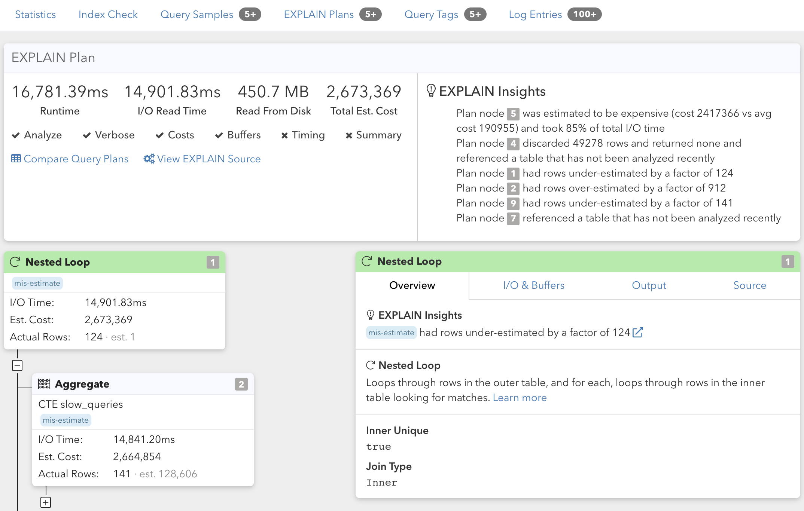

The recommended way to set up Automated EXPLAIN is to use the Postgres `auto_explain` module.
This module is part of core Postgres but is not enabled by default. It can instrument all queries
on your system and log detailed execution information for ones slower than a certain threshold.
With our recommended configuration, performance impact is minimal.

Here are the instructions for environments that support `auto_explain`:

 * [Amazon RDS and Amazon Aurora](amazon-rds/01-auto_explain-check)
 * [Azure Database for PostgreSQL](azure-database/01-auto_explain-check)
 * [Google Cloud SQL and AlloyDB](google-cloud-sql/01-auto_explain-check)
 * [Crunchy Bridge](crunchy-bridge/01-auto_explain-check)
 * [Heroku Postgres](heroku/01-auto_explain-check)
 * [CloudNativePG (CNPG)](cloudnative-pg/01-auto_explain-check)
 * [Self-Managed Server](self-managed/01-auto_explain-check)

For other environments, we also offer an alternative [log-based Automated EXPLAIN](log-explain) mechanism.

EXPLAIN plans are visualized on the associated query detail page, and include **[EXPLAIN insights](/docs/explain)**:

