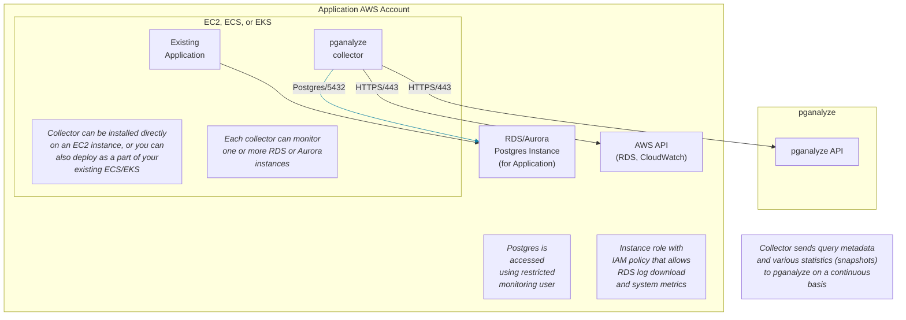

To monitor your Amazon RDS for PostgreSQL or Amazon Aurora PostgreSQL instances
with pganalyze, you need to run the pganalyze collector. The pganalyze collector
connects to your database to capture query metadata and various statistics, then
relays this information back to pganalyze on a continuous basis.
The collector can be installed directly on an Amazon EC2 instance, with Amazon
ECS, or with Docker.

## Prerequisites

**Database Instance**
* Amazon RDS for PostgreSQL or Amazon Aurora PostgreSQL instance to monitor
* PostgreSQL version 10 or above
* Access with an RDS superuser (master user)
  * Required to create a monitoring user, extensions, and helper functions
  * _This is only required during setup_

**Collector Setup**
* Capability to create an instance for running the collector
  * The collector instance needs to be able to connect to RDS or Aurora instances
* Capability to create an IAM policy/role for the collector
  * A new policy/role is required to access to the RDS metadata, Cloudwatch
    metrics, etc.
* A direct connection to the PostgreSQL instance
  * The collector instance needs to be able to connect to the instance directly,
    bypassing any connection poolers like PgBouncer

Here is an overview diagram for how the pganalyze collector will be placed
within your existing setup.

The collector can be installed in a different AWS account from the one hosting the
RDS/Aurora instance, provided that the collector can establish a connection to
the RDS/Aurora instance (e.g., using VPC Peering).
Additionally, the collector must be set up to assume an IAM role from the RDS
side, which should have the appropriate policies for accessing RDS logs and
system metrics. This role must include a trusted policy that permits the
collector's account to assume it.

Continue by configuring RDS instance:

<Link className="btn btn-success" to="01_configure_rds_instance">
  Proceed to Step 1: Configure RDS Instance
</Link>
