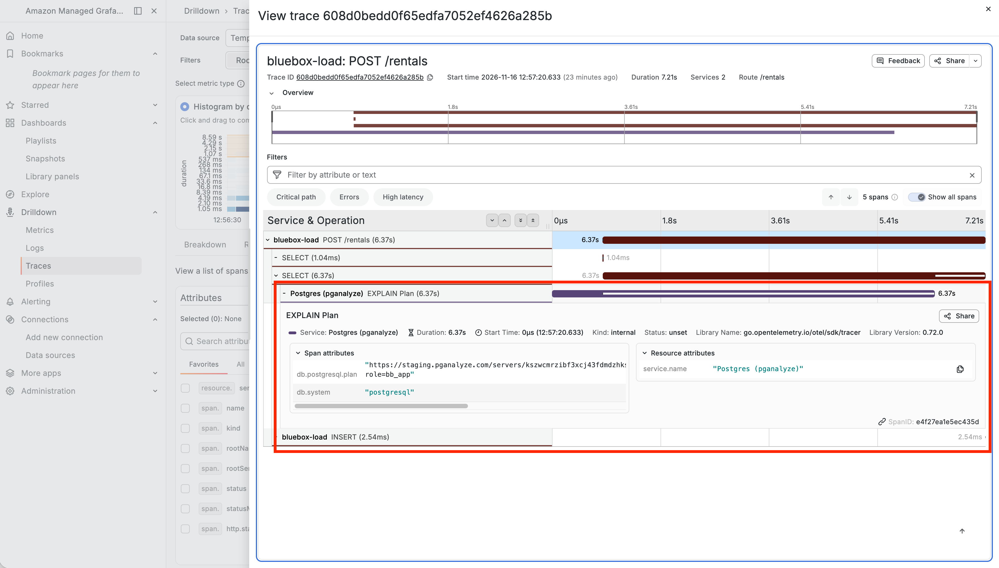

You can set up the pganalyze collector OpenTelemetry exporter with Grafana Tempo
to capture spans for query EXPLAIN plans inside your traces.
The span contains the link to the EXPLAIN plan in the pganalyze app, so that you
can easily visit the pganalyze page to find out why the query is slow.



Grafana Tempo accepts traces over OTLP, so the pganalyze collector can send
spans either to a self-hosted Tempo instance or directly to
[Grafana Cloud](https://grafana.com/products/cloud/) (which hosts Tempo for
you).

## Setup steps

1. [Start sending tracing data from your application to Grafana Tempo](#start-sending-tracing-data-from-your-application-to-grafana-tempo)
2. [Add traceparent query tag to the query](#add-traceparent-query-tag-to-the-query)
3. Set up the pganalyze collector, either
   [with self-hosted Tempo](#set-up-the-pganalyze-collector-with-self-hosted-tempo)
   or [with Grafana Cloud](#set-up-the-pganalyze-collector-with-grafana-cloud)

### Start sending tracing data from your application to Grafana Tempo

Send traces from your application to Tempo using OpenTelemetry SDKs. See the
[Grafana Cloud documentation](https://grafana.com/docs/grafana-cloud/send-data/otlp/send-data-otlp/)
or the [Tempo documentation](https://grafana.com/docs/tempo/latest/) for details.

### Add traceparent query tag to the query

Follow the [traceparent documentation](/docs/opentelemetry/traceparent) to add a
traceparent query tag to the queries issued by your application.

### Set up the pganalyze collector with self-hosted Tempo

If you run Tempo yourself, enable the
[OTLP receiver](https://grafana.com/docs/tempo/latest/configuration/#distributor)
in the Tempo distributor. This requires network connectivity between the
pganalyze collector and the Tempo OTLP endpoint.

Set `otel_exporter_otlp_endpoint` (`OTEL_EXPORTER_OTLP_ENDPOINT`) to the
OTLP/HTTP endpoint, for example:

```bash
# pganalyze-collector environment variables
OTEL_EXPORTER_OTLP_ENDPOINT=http://10.0.0.42:4318
```

In this case `10.0.0.42` is the IP of the VM/container running Tempo. If your
endpoint requires authentication, pass the credentials with
`otel_exporter_otlp_headers` (`OTEL_EXPORTER_OTLP_HEADERS`).

The pganalyze collector also supports OTLP over gRPC (typically port 4317), but
only with TLS. If your Tempo receiver only exposes gRPC, use an `https://`
endpoint, for example `grpc://tempo.example.com:4317`, and make sure the
receiver (or a proxy in front of it) presents a certificate that the collector
trusts. A plain `http://` endpoint on port 4317 will not work. Use whichever
protocol your receiver exposes.

### Set up the pganalyze collector with Grafana Cloud

Grafana Cloud provides an OTLP gateway to which the pganalyze collector can
send spans directly.

1. In the Grafana Cloud Portal, open your stack and locate the
   **OpenTelemetry** connection details. Copy the OTLP endpoint and the
   OpenTelemetry instance ID shown there. The endpoint typically resembles
   `https://otlp-gateway-<zone>.grafana.net/otlp`. Use the exact endpoint and
   instance ID shown for your stack, since the OpenTelemetry instance ID may
   differ from other Grafana Cloud instance or stack IDs.

2. Create a [Cloud Access Policy](https://grafana.com/docs/grafana-cloud/platform/security-and-account-management/security-and-access/authentication-and-permissions/access-policies/create-access-policies/)
   for the stack with the `traces:write` scope, and then create a token for
   that policy. You may reuse an existing token if its access policy applies to
   the same stack and already includes `traces:write`. However, a dedicated,
   least-privilege token can make credential rotation and revocation easier.

3. Grafana Cloud's OTLP gateway uses HTTP Basic authentication. Construct the
   credentials by joining the OpenTelemetry instance ID and access policy token
   with a colon, and then Base64-encoding the complete value:

   ```text
   <OTLP instance ID>:<access policy token>
   ```

   For example:

   ```bash
   printf '%s' '123456:glc_xxxxxxxx' | base64 | tr -d '\n'
   ```

   The output must be a single line without a trailing newline. Base64 is an
   encoding rather than encryption, so the token should still be treated as a
   secret.

Then configure the following collector settings:

* `otel_exporter_otlp_endpoint` (`OTEL_EXPORTER_OTLP_ENDPOINT`):
  * `https://otlp-gateway-<zone>.grafana.net/otlp`
* `otel_exporter_otlp_headers` (`OTEL_EXPORTER_OTLP_HEADERS`):
  * `Authorization=Basic%20<base64 encoded instance ID and token>`

Replace the placeholders with the values from your Grafana Cloud stack, and do
not include the angle brackets.

The space between `Basic` and the encoded credentials is written as `%20`
because `OTEL_EXPORTER_OTLP_HEADERS` uses a percent-encoded key/value format.
The collector decodes `%20` into a space when constructing the HTTP
`Authorization` header.

For example, if the Base64 output were `MTIzNDU2OmdsY194eHh4eHh4eA==`, the
complete setting would be:

```bash
otel_exporter_otlp_headers: Authorization=Basic%20MTIzNDU2OmdsY194eHh4eHh4eA==
```

### Optional settings

You can also set `otel_service_name` (`OTEL_SERVICE_NAME`) to update the service
name reported to Grafana from the pganalyze collector. It defaults to
`Postgres (pganalyze)`.

Make sure to restart the collector after updating the settings.

## Finding the EXPLAIN plan spans

In Grafana, open **Explore**, select your Tempo data source, and search for the
service name (by default `Postgres (pganalyze)`) or the span name
`EXPLAIN Plan`. The span shows up inside the application trace that issued the
query, and its `db.postgresql.plan` attribute links to the full plan in
pganalyze.

## Additional resources

For additional details, see:

* [Send data to the Grafana Cloud OTLP endpoint](https://grafana.com/docs/grafana-cloud/send-data/otlp/send-data-otlp/)
* [Grafana Cloud access policies and scopes](https://grafana.com/docs/grafana-cloud/platform/security-and-account-management/security-and-access/authentication-and-permissions/access-policies/)
* [pganalyze collector OpenTelemetry exporter settings](/docs/collector/settings#opentelemetry-exporter-settings)
