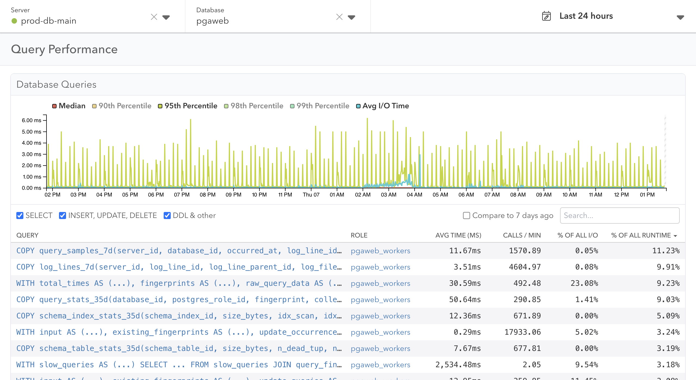
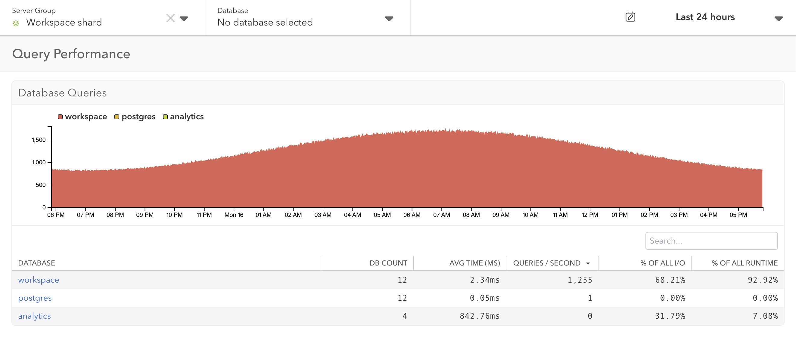
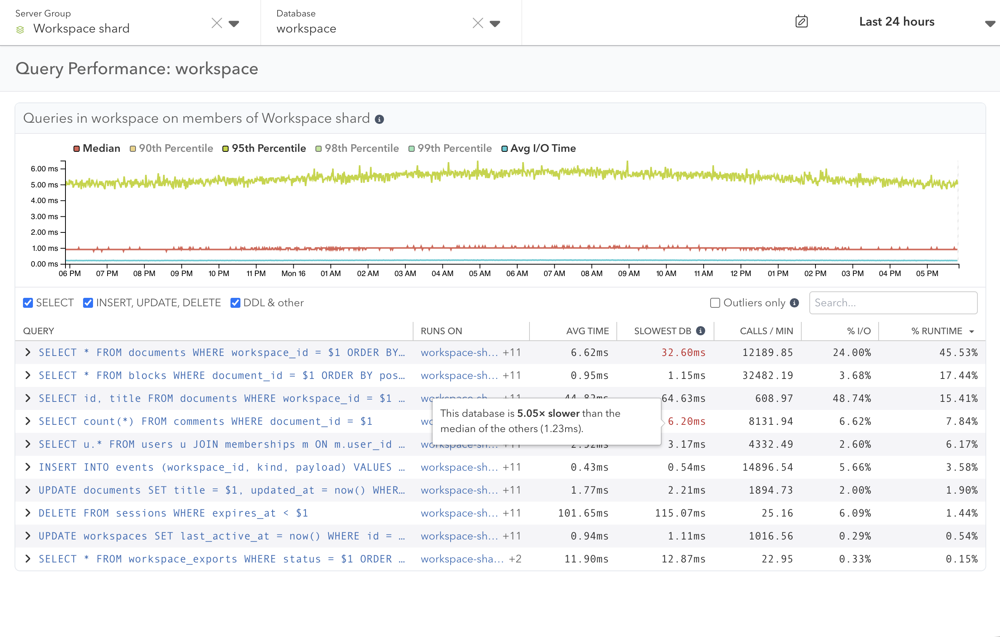
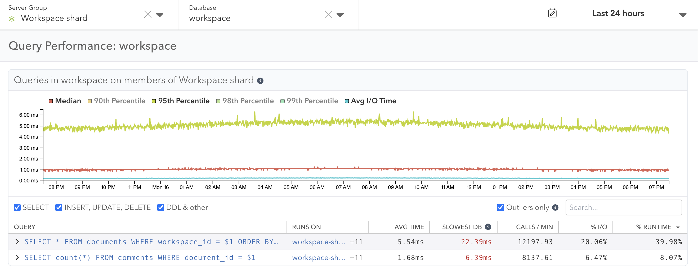
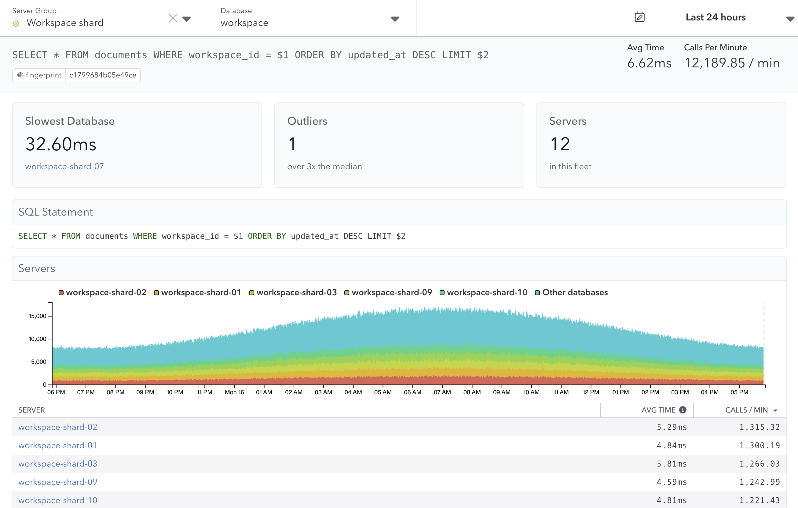
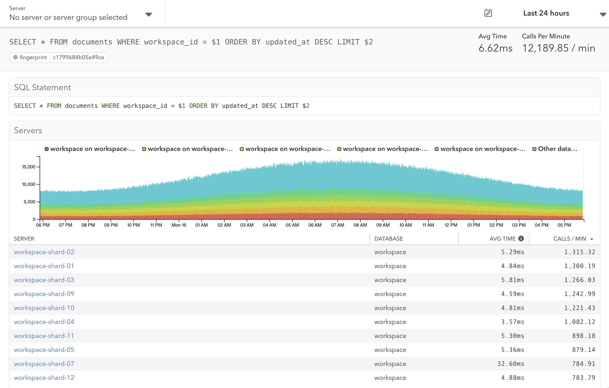

The Query Performance page in pganalyze contains information about query
statistics, using the data from the `pg_stat_statements` view.

The query statistic data is collected every minute and is sent to pganalyze
every 10 minutes.

## Database Queries

Once you specify a database, you can see statistics for queries in that
database. The chart displays the overall query latency.

In the table below the chart, you can find a list of all queries in the
database (subject to [pg_stat_statements.max](https://www.postgresql.org/docs/current/pgstatstatements.html#PGSTATSTATEMENTS-CONFIG-PARAMS)).
The list is sorted by the percentage of all runtime by default. You can search
this list by part of the query text, or the name of the Postgres roles executing
the query.

### Group-Wide Query Performance

For servers in a [server group or cluster](/docs/accounts/server-groups#server-groups-and-clusters), the same view is available across the whole group. The default page summarizes query activity per database group, which are databases that share a name across members. DB Count is the number of members where that database is monitored. The other columns work as they do on a single server's Query Performance page, computed across every member in the group.

#### Merged Queries

Pick a database group to see its queries. A query that runs on several members appears as one row, with its statistics combined across every member that runs it. Queries are matched by their fingerprint, which ignores comments and formatting, so the text shown is from the slowest database and may differ slightly from the others. Open a database's own query page for its exact text.

Avg Time, Calls / min, % I/O, and % Runtime work as they do for a single database, computed across every member that runs the query. Two columns are specific to the group view:

* Runs On names the server where the query is slowest, followed by how many other databases run it.
* Slowest DB shows the average time on the slowest database. We exclude databases with under 10% of the average calls per database, so a quiet database with only a few calls can't be the slowest. It turns red when it is over 3× the median of the other databases. Hover over it to see how much slower it is than that median.

Expand a row to list every database running the query, slowest first, each linking to its query on that database. The first 10 show by default, and Show all lists the rest. This is especially useful in two cases:

* For a cluster, the expanded rows show how read traffic is actually distributed between the primary and its replicas, so you can see which queries are landing where.
* For a sharded database, a server group can represent the shard set with a [match rule](/docs/accounts/server-groups#match-rules) on server name, picking up new shards as they are added. Expanded rows then show which shards run a query slowest, without checking one shard at a time.

#### Outliers

Check Outliers only to list just the queries whose Slowest DB is red. It takes the place of Compare to 7 days ago, which is not available in the group view.

#### Query Group Zoom

Selecting a query opens that query across every database in the group that runs it. Tiles at the top show the slowest database, how many databases are outliers, and how many servers run the query. The Servers panel graphs calls per minute for the 5 busiest databases, with the rest combined as Other databases. The list below it shows each server with its average time and calls per minute.

To view per-database query samples, EXPLAIN plans, and Index Advisor, select a server in the table.

#### Query Org Zoom

To see the same query across every server you can access, clear the server group in the Server Group dropdown. Outliers are not flagged here, since only databases in a group are peers.

### How percentiles are calculated

Our percentile calculations use weighted averages of execution times, derived
from total times and call frequencies, rather than direct raw execution times.
This streamlined approach, however, might not highlight outliers as effectively.

For example, with query statistics over 10 minutes:

* query1: total time 8,000ms for 10 calls, averaging 800ms
* query2: total time 8,000ms for 20 calls, averaging 400ms
* query3: total time 9,000ms for 30 calls, averaging 300ms
* query4: total time 8,000ms for 40 calls, averaging 200ms

This process generates a dataset like `[200ms (40 times), 300ms (30 times), 400ms (20 times), 800ms (10 times)]`.
The median is 300ms, but this method might not fully represent outliers. For
instance, if query1 had two exceptionally slow runs (2,000ms each), the true
99th percentile might be 2,000ms, not 800ms as our averaged data would suggest.

## Query details

### Overview

The SQL Statement you can see here is a normalized query and all values are
replaced by placeholders, such as `$1`.

#### Query can be truncated

When the query exceeds the current size limit set by `track_activity_query_size`,
it will be shown as `<truncated query>`. If you encounter this frequently,
consider increasing this limit. Be aware that increasing the limit may result in
Postgres consuming more memory.

### Index Advisor

You can see the list of scans executed by this query here. A scan is how a query
reads data from a table (either through an index or as a sequential scan). For
each scan, the Index Advisor will show if there are any recommended changes.

### Query Samples

Shows the list of query samples collected in the last 24 hours, regardless of
the selected time range, up to 5 samples. This is only available when Log
Insights is integrated and the query execution time exceeds either
`log_min_duration_statement` or `auto_explain.log_min_duration`.

### EXPLAIN Plans

Shows the list of EXPLAIN plans samples collected in the selected time range.
This is only available when [Automated EXPLAIN](/docs/explain/setup) is
integrated and the query execution time exceeds `auto_explain.log_min_duration`.
With Amazon Aurora versions 14.10, 15.5, and higher, this page also displays
query plan statistics, including a list of query plans with their statistics,
and graphs showing the average runtime and calls per minute over time for each
plan.

### Query Tags

Shows the list of query tags collected in the last 7 days, regardless of the
selected time range. See [Query Tags](/docs/query-performance/query-tags)
section for more detail.

### Log Entries

Shows up to 100 log entries, up to the selected time range's "to" time (or
the current time if the selected time range is something like Last 24 hours).
